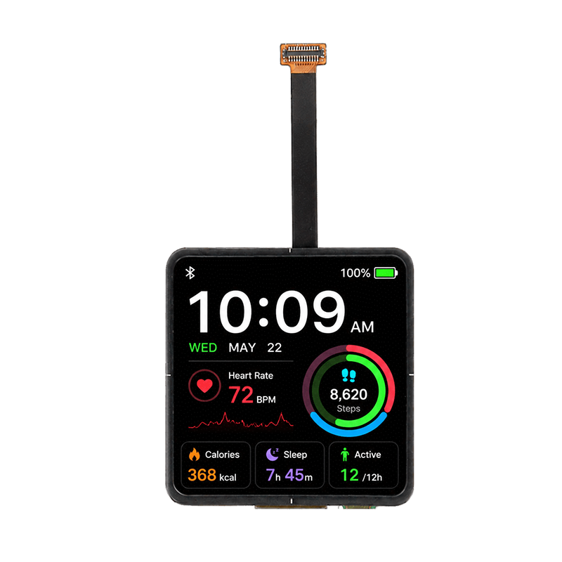

<h1 align="center">OSPTEK 2″ AMOLED Display 460×460</h1>

<b>AMOLED module · Multi-Version Index</b>

English | <a href="./README.md">简体中文</a>

  
  
  
  

## Contents

- [About](#about)
- [Versions](#versions)
- [Sample Projects](#sample-projects)
- [Where to Buy](#where-to-buy)
- [Support](#support)

---

## About

This repository holds materials for the **2″ 460×460 AMOLED** display module family. There may be multiple versions under the same spec; see each version's own README under `versions/` for driver chip, touch, and interface details.

The **root README is the navigation page**. Use the table below for a quick scan; open **Full docs** to enter that **part-number folder** under `versions/` (product page, datasheets, etc. live there). Sample projects are not split per version — they all live under the repo root [`examples/`](./examples/); see "Sample Projects" below.

Repo id: `display-amoled-2inch-460x460`

---

## Versions

| Version | Image | Driver IC | Touch IC | Interface | Full docs |
| ------- | ----- | --------- | -------- | --------- | --------- |
| AM200MT460460FLS2 |  | CO5300 | — | MIPI | [Full docs](./versions/AM200MT460460FLS2/) |
| AM200Q460460FLS1 |  | CO5300 | — | QSPI | [Full docs](./versions/AM200Q460460FLS1/) |
| AM200Q460460LK |  | CO5300 | CST820 | QSPI | [Full docs](./versions/AM200Q460460LK/) |

---

## Sample Projects

Sample code is in the [`examples/`](./examples/) folder.

---

## Where to Buy

  
  &nbsp;&nbsp;
  

**International (AliExpress)**

- Store: [OSPTEK Official Store](https://www.aliexpress.com/store/1105701619)

**China (Taobao)**

- Store: [鱼鹰光电工厂店](https://shop110742373.taobao.com/)

---

## Support

- Technical Support / Sales: <luyu@osptek.com>
- QQ Technical Group: **985881096**
- Website: <https://osptek.com/>
- Feel free to open an Issue in this repository if you have any questions

---

© 2026 OSPTEK · Licensed under CC BY 4.0

